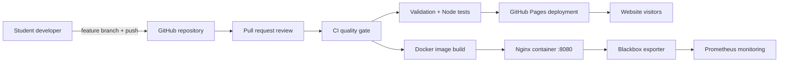

# Architecture and delivery flow

## Components

| Layer | Implementation | Purpose |
| --- | --- | --- |
| Source control | Git and GitHub | Shared history, branches and reviews |
| Application | HTML, CSS, JavaScript and JSON | Responsive, data-driven college website |
| Build | Node.js script | Produces immutable `dist/` and release metadata |
| Test | Node test runner and custom validator | Quality gate without hidden global tooling |
| Runtime | Multi-stage Docker build and Nginx | Reproducible production container |
| CI/CD | GitHub Actions | Test, container-build and deploy on every change |
| Security | CodeQL, npm audit, Dependabot and headers | Automated preventive controls |
| Monitoring | Prometheus and Blackbox Exporter | HTTP availability checks and alert rule |

The same tested `dist/` artifact is passed into the deployment job. Deployment cannot start unless both the quality gate and container build succeed.
